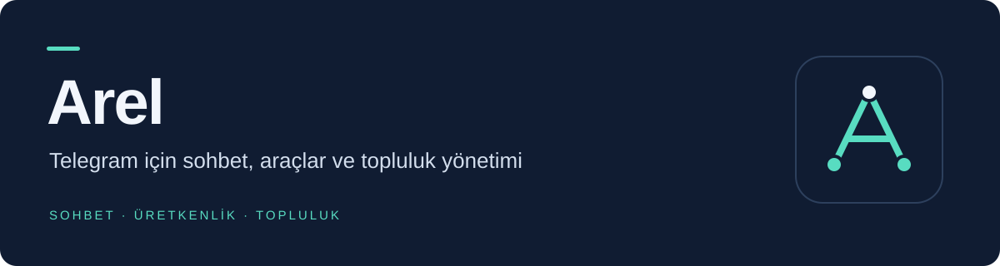
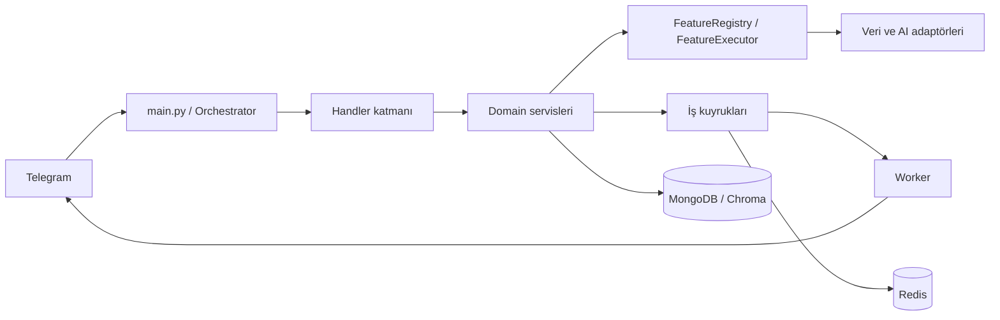

<div align="center">

Günlük işlerini düzenle. Bilgiye ulaş. İçerik üret. Birlikte oyna.

[Özellik rehberi](docs/FEATURES.md) · [Kurulum](#kurulum) · [Mimari](#mimari) · [Operasyon](docs/OPERATIONS.md)

</div>

---

Arel, özel sohbetlerde ve Telegram gruplarında çalışan modüler bir Python botudur. Sohbet ve belge analizi, medya indirme, notlar, hatırlatıcılar, güncel veri araçları, sticker ve alıntılar, oyunlar ve yönetici kontrollerini tek bir arayüzde toplar.

> **Mevcut kaynak sürümü:** İncelenen `242a1ec` commit'inde komut handler'ında sözdizimi ve şehir dizininde import hatası bulunuyor. Başlangıç ve test kapıları bu engeller giderilene kadar **HOLD** durumundadır. Aşağıdaki rehber kaynakta tanımlı yetenekleri anlatır; sunucudaki farklı dağıtımın canlı kabulü ayrıca değerlendirilir.

## Neler yapar?

| Alan | Kaynakta bulunan yetenekler |
|---|---|
| **Sohbet ve yapay zekâ** | Bağlamlı sohbet, çeviri, web araması, hikâye ve görsel üretimi; görsel/ses işleme ve seslendirme |
| **Belgeler ve hafıza** | PDF, DOCX ve TXT üzerinde arama; kişisel belge yönetimi ve açık rızaya bağlı kalıcı hafıza |
| **Kişisel düzen** | Notlar, görevler, günlük/haftalık plan, tek seferlik veya tekrarlı hatırlatıcılar |
| **Bilgi ve takip** | Hava, hava kalitesi, deprem, haber, kur, altın, kripto, borsa, eczane, akaryakıt, namaz vakitleri ve aktüel ürünler |
| **Medya ve sticker** | Desteklenen herkese açık bağlantıları indirme; statik/video sticker, kişisel paketler, mesaj alıntıları |
| **Oyun ve topluluk** | Quiz, kelime oyunları, adam asmaca, batak, blackjack ve sosyal oyunlar; puan, başarımlar, sezon ve sanal coin |
| **Grup yönetimi** | Moderasyon, sohbet ayarları, karşılama/ayrılma mesajları, zamanlanmış duyurular ve grup istatistikleri |

Yeteneklerin komutları, koşulları ve kaynakları [özellik rehberinde](docs/FEATURES.md) yer alır. Kullanılabilirlik; yapılandırmaya, dış servis erişimine, Telegram izinlerine ve çalışan işleyicilere bağlıdır. Uçuş aracı arama bağlantısı üretir; canlı fiyat veya rezervasyon hizmeti sunmaz.

## Kullanım örnekleri

Bot ile özel sohbet açıp `/start` veya `/menu` yazın. `/help` yardım ekranını, `/ayar` sohbet ayarlarını açar.

```text
/not Toplantı için gündem hazırla
/gorev Raporu tamamla
/remind yarın 10:00 Toplantı
/plan hafta
/hava İstanbul
/ara Python belgeleri
/oyun
```

Bir mesaja yanıt olarak `/q` ile alıntı, desteklenen bir görsele/videoya yanıt olarak `/sticker` ile sticker oluşturma akışı vardır. `/bildirim` takip merkezini açar; grup ortak bildirimlerini grup yöneticileri düzenler.

## Kurulum

### Gereksinimler

- Python 3.11 tabanlı Docker imajı ve Docker Compose desteği; yerel Python yolu için Python 3.11/3.12.
- Telegram bot tokenı, bot sahibinin sayısal Telegram kullanıcı kimliği ve en az bir geçerli yapay zekâ bağlantısı. Başlangıç doğrulaması bot ve birleşik çalışma rollerinde bir AI anahtarı arar.
- Kalıcı çalışma için MongoDB ve Redis. Geliştirme Compose profili ikisini de başlatır.
- Görsel, ses, arama ve medya özellikleri için ilgili servis ayarları. Video işlemleri FFmpeg/FFprobe kullanır; Docker imajı bunları içerir.

Önce yukarıdaki kaynak hatalarını giderip Python derleme kontrolü ve testleri çalıştırın. Hata içeren HEAD'i canlı sürümün üzerine dağıtmayın.

### Geliştirme ortamı

Repository kökünde örnek ortam dosyasını kopyalayın:

```powershell
Copy-Item .env.example .env
```

`.env` içinde `TELEGRAM_TOKEN` ve `OWNER_ID` değerlerini girin; kullanacağınız AI bağlantısının anahtarını, URL ve modelini yapılandırın. AI yönlendirme sırasının bu bağlantıyı içerdiğini kontrol edin. Geliştirme için `TELEGRAM_MODE=polling`, `APP_ENV=development` ve `APP_ROLE=combined` kullanın. Örnek anahtarları gerçek değer olarak bırakmayın; sırları Git'e eklemeyin.

```powershell
docker compose --profile dev up --build
```

Bu profil botu ve işleyicileri aynı süreçte çalıştırır; MongoDB, Redis, indirmeler ve belge deposu için Compose disk birimlerini kullanır. Aynı tokenla ikinci bir polling süreci açmayın.

### Docker olmadan

MongoDB ve Redis erişilebilir olmalı; `.env` içindeki bağlantılar makinenize göre düzenlenmelidir. Medya için FFmpeg/FFprobe ve indirme adaptörünün ihtiyaç duyduğu JavaScript çalışma ortamını ayrıca kurun.

```powershell
python -m venv .venv
.\.venv\Scripts\Activate.ps1
python -m pip install -c constraints.txt -r requirements.txt
python main.py
```

Linux'ta ortamı `source .venv/bin/activate` ile etkinleştirin. İsteğe bağlı MCP entegrasyonu `requirements-optional.txt` içindeki ek bağımlılıkları gerektirir.

### Sunucuya dağıtım

Üretim Compose profili bot ile worker'ı ayırır; MongoDB/Redis gereksinimlerini sıkılaştırır. Webhook kurulumu HTTPS ters vekil, webhook sırrı ve doğru port eşlemesini gerektirir. Dış veri kaynaklarının onay durumu da üretimde özellik erişimini etkiler.

Dağıtım, yedekleme, sağlık kontrolleri, izleme ve geri dönüş için [DEPLOYMENT.md](DEPLOYMENT.md) ve [operasyon rehberini](docs/OPERATIONS.md) izleyin. Bir servisin açılması bütün özelliklerin üretim kabulü sayılmaz.

## Mimari



| Dizin | Sorumluluk |
|---|---|
| `src/handlers` | Telegram komutları, mesajlar ve callback girişleri |
| `src/features` | Özellik sözleşmeleri, kayıt, erişim politikası ve veri adaptörleri |
| `src/ai`, `src/tools` | AI yönlendirmesi, model adaptörleri ve araçlar |
| `src/services` | Kişisel düzen, bildirim, grup, oyun ve sunum servisleri |
| `src/media`, `src/attachments`, `src/documents` | İndirme, ek dosya ve belge işleme kuyrukları |
| `src/games`, `src/quotes`, `src/stickers` | Oyun kuralları, alıntı ve sticker işlemleri |
| `src/storage`, `src/database`, `src/security` | Kalıcı veri erişimi ve ortak güvenlik kontrolleri |
| `deploy`, `scripts`, `src/tests` | Dağıtım, denetim araçları ve testler |

Şema bileşenlerin sorumluluklarını özetler. Mimari hedefleri [ARCHITECTURE.md](docs/ARCHITECTURE.md), katkı kurallarını [AGENTS.md](AGENTS.md) açıklar; kurallara uyum ayrıca denetlenir.

## Kalite ve doğrulama

Bağımlılıkların kurulduğu ortamda:

```text
python -m compileall -q main.py src config.py
python -m pytest -q
python scripts/architecture_check.py --strict
python scripts/feature_catalog_audit.py
python scripts/phase_audit.py
```

Bunlar test ve denetim girişleridir; burada başarılı çalıştırıldıkları iddia edilmez. Dış servislerin, Telegram tesliminin ve yeniden başlatma sonrası toparlanmanın kabulü ayrıca canlı kanıt gerektirir. [RELEASE_READINESS.md](docs/RELEASE_READINESS.md) sürüm kabul ölçütlerini içerir.

## Dokümantasyon

| Rehber | İçerik |
|---|---|
| [Özellikler ve komutlar](docs/FEATURES.md) | Kullanıcı yetenekleri, örnekler, erişim koşulları ve kaynaklar |
| [Teknik özellik kataloğu](docs/FEATURE_CATALOG.md) | Registry anahtarları ve teknik sözleşmeler |
| [Mimari](docs/ARCHITECTURE.md) | Bileşenler ve hedef sınırlar |
| [Dağıtım](DEPLOYMENT.md) · [Operasyon](docs/OPERATIONS.md) | Kurulum, bakım, yedekleme ve izleme |
| [Veri kaynakları](docs/DATA_SOURCES.md) · [Lisans kayıtları](LICENSES.md) | Dış kaynaklar, atıf ve kullanım koşulları |

Özellik eklerken komut kaydını, registry tanımını, testleri ve ilgili rehberleri birlikte güncelleyin. `.env`, erişim anahtarları, kullanıcı belgeleri ve indirilen içerikler repository'ye eklenmemelidir.
