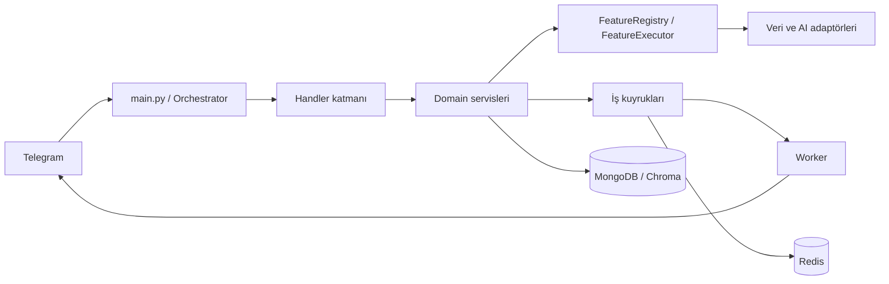

<div align="center">

**Sohbet et · Birlikte oyna · Gününü düzenle · Grubunu yönet**

[Özellikler](docs/FEATURES.md) · [45 oyun](docs/GAMES.md) · [Kurulum](#kurulum) · [Operasyon](docs/OPERATIONS.md)

</div>

Arel, özel sohbetler ve Telegram grupları için geliştirilen açık kaynak bir Python botudur. **45 oyun** ve **91 kayıtlı özellik**; sohbet, üretkenlik, güncel bilgi, medya ve moderasyon araçlarıyla aynı menüde buluşur.

## Özellikler

| Alan | İçerik |
|---|---|
| **Sohbet ve üretim** | Bağlamlı Türkçe sohbet, kullanıcı/konu odaklı grup yanıtı; açık seçimli Normal ve Roast; çeviri, web araması, sayfa okuma, hikâye, görsel üretimi, görsel analizi/OCR, ses çözümleme ve seslendirme |
| **Belgeler ve hafıza** | PDF/DOCX/TXT yükleme, kişisel belgelerde arama, belge listeleme/silme; izinli kalıcı hafıza, kayıtları görme ve temizleme |
| **Günlük düzen** | Notlar, görevler, günlük/haftalık plan, Türkçe tarihli ve tekrarlı hatırlatıcılar, günlük özet, sessiz saatler, takip ve eşik alarmları |
| **Bilgi araçları** | Şehir/ilçe, plaka/telefon kodu, hava ve hava kalitesi, deprem, nöbetçi eczane, akaryakıt, namaz, BİM aktüel; uçuş arama bağlantıları |
| **Finans ve kültür** | Döviz/altın, kripto/borsa ve grafikler; kategorili haberler ve özet; film, dizi, kitap, müzik önerileri ve şarkı sözü araması |
| **Medya ve sticker** | Desteklenen herkese açık medyayı indirme, dönüştürme, iş takibi/iptal; görsel mesaj alıntıları, temalar, alıntı arşivi; statik/video sticker, arama, etiketleme ve kişisel paket yönetimi |
| **Oyun ve ekonomi** | Aşağıdaki 45 oyun; inline görselli kart elleri, lobiler, özel roller, skor/profil, başarımlar, sezon, sanal bakiye, günlük ödül, mağaza ve envanter |
| **Topluluk yönetimi** | Yetkili moderasyon, uyarı/ceza, flood/link/kelime/medya koruması, captcha/raid, karşılama/veda, grup notları/filtreler, duyurular, istatistikler, federasyon ve raporlama |
| **İşletim** | Inline arama, kapsamlı komut menüleri, özellik anahtarları; bot/worker ayrımı, kalıcı kuyruk, önbellek, sağlık/ölçüm, yedekleme ve geri dönüş araçları |

[Tüm komutlar ve kullanım koşulları →](docs/FEATURES.md) · [91 özellik için teknik kayıt →](docs/FEATURE_CATALOG.md)

## 45 oyun, tek salon

| Kategori | Oyunlar |
|---|---|
| **Kelime** | Kelime Oyunu, Anlatmaca, Adam Asmaca, Kelime Zinciri, Türkçe Wordle, Karşı Kelime, Anagram, Harf Maratonu, Sözcük Avı, Yasak Harf |
| **Tahta ve bulmaca** | Connect Four, Gomoku / Beşli, Satranç, XOX, Hafıza Eşleştirme, Mayın Tarlası, Sudoku, Amiral Battı, 2048 |
| **Bilgi ve tahmin** | Akinatör, Yaş Tahmini, Bilgi Yarışması, Sayı Tahmini, Kör Sıralama, Kronoloji, Doğru–Yanlış, Dedektif, Beş İpucu, Emoji Bilmece |
| **Kart** | UNO, Batak, Blackjack, Pişti, Papaz Kimde |
| **Grup oyunları** | Takım Tabu, Casus, Vampir Köylü, Refleks, Ortak Hikâye, Bomba, İki Doğru Bir Yalan, Kimim Ben, Takım Bilgi Ligi, Zehirli Kadeh |
| **Sosyal** | Şişe Çevirme |

`/oyun` salonu açar. [Oyun rehberi](docs/GAMES.md) her oyunun komutunu, oyuncu sayısını ve mekaniğini açıklar. Zar, yazı-tura ve doğruluk/cesaret gibi ek mini etkileşimler de bulunur.

## Hızlı kullanım

```text
/start
/menu
/hava İstanbul
/not Toplantı gündemini hazırla
/remind yarın 10:00 Toplantı
/oyun
/uno
/image Mavi seramik çaydanlık --model prism
```

Bir mesaja `/q` ile yanıt vererek alıntı, uygun medyaya `/sticker` ile yanıt vererek sticker oluşturun. `/ayar` sohbet tercihlerini, `/bildirim` takip panelini açar.

## Güncel durum

Normal kişilik samimi ve esprili Türkçe kullanır; ciddi konularda üslubunu uyarlar. Roast ayrı ve açık seçimlidir. Sohbette normal **Codex CLI** birincildir; zaman bütçesi ve hata geçişi korunur. Görselde Prism/Flare ve mevcut yedek hat vardır.

**Prism ve Flare için açık dış sorun:** 23 Ekim’de iki model HRMN tarafından listelenmesine rağmen yerelden ve sunucudan `HTTP 500 / no provider responded` döndürdü. Model seçilmemiş istekler mevcut yedeğe geçer; açık model seçimi başka modelmiş gibi başarılı gösterilmez. [Tanı ve yeniden test](docs/HRMN_IMAGE_DIAGNOSIS_2026-10-23.md).

Güncel yerel kontrollerde **3.256 test geçti, 19 atlandı**; önceki dağıtımda canlı sohbet ve yedek görsel üretimi API üzerinden doğrulandı. Bunlar tüm oyunların gerçek oyuncularla Telegram kabulü değildir. Güncel kapsam: [dağıtım kanıtı](docs/IMAGE_DEPLOYMENT_2026-10-23.md), [faz kaydı](docs/PHASE_STATUS.json).

## Kurulum

### Gereksinimler

- Python 3.12 tabanlı Docker imajı ve Docker Compose desteği; yerel Python 3.12 önerilir (`akipy` Akinator istemcisi Python 3.12+ ister).
- Telegram bot tokenı, bot sahibinin sayısal Telegram kullanıcı kimliği ve en az bir geçerli yapay zekâ bağlantısı. Başlangıç doğrulaması bot ve birleşik çalışma rollerinde bir AI anahtarı arar.
- Kalıcı çalışma için MongoDB ve Redis. Geliştirme Compose profili ikisini de başlatır.
- Görsel, ses, arama ve medya özellikleri için ilgili servis ayarları. Video işlemleri FFmpeg/FFprobe kullanır; Docker imajı bunları içerir.

Dağıtımdan önce Python derleme kontrolünü, testleri, kaynak onayını ve paket/imaj özetlerini doğrulayın. Test başarısı, her komutun Telegram üzerinde uçtan uca kabul edildiği anlamına gelmez.

### Geliştirme ortamı

Repository kökünde örnek ortam dosyasını kopyalayın:

```powershell
Copy-Item .env.example .env
```

`.env` içinde `TELEGRAM_TOKEN` ve `OWNER_ID` değerlerini girin; kullanacağınız AI bağlantısının anahtarını, URL ve modelini yapılandırın. AI yönlendirme sırasının bu bağlantıyı içerdiğini kontrol edin. Geliştirme için `TELEGRAM_MODE=polling`, `APP_ENV=development` ve `APP_ROLE=combined` kullanın. Örnek anahtarları gerçek değer olarak bırakmayın; sırları Git'e eklemeyin.

```powershell
docker compose --profile dev up --build
```

Bu profil botu ve işleyicileri aynı süreçte çalıştırır; MongoDB, Redis, indirmeler ve belge deposu için Compose disk birimlerini kullanır. Aynı tokenla ikinci bir polling süreci açmayın.

### Docker olmadan

MongoDB ve Redis erişilebilir olmalı; `.env` içindeki bağlantılar makinenize göre düzenlenmelidir. Medya için FFmpeg/FFprobe ve indirme adaptörünün ihtiyaç duyduğu JavaScript çalışma ortamını ayrıca kurun.

```powershell
python -m venv .venv
.\.venv\Scripts\Activate.ps1
python -m pip install -c constraints.txt -r requirements.txt
python main.py
```

Linux'ta ortamı `source .venv/bin/activate` ile etkinleştirin. İsteğe bağlı MCP entegrasyonu `requirements-optional.txt` içindeki ek bağımlılıkları gerektirir.

### Sunucuya dağıtım

Üretim Compose profili bot ile worker'ı ayırır; MongoDB/Redis gereksinimlerini sıkılaştırır. Webhook kurulumu HTTPS ters vekil, webhook sırrı ve doğru port eşlemesini gerektirir. Dış veri kaynaklarının onay durumu da üretimde özellik erişimini etkiler.

Dağıtım, yedekleme, sağlık kontrolleri, izleme ve geri dönüş için [DEPLOYMENT.md](DEPLOYMENT.md) ve [operasyon rehberini](docs/OPERATIONS.md) izleyin. Bir servisin açılması bütün özelliklerin üretim kabulü sayılmaz.

## Mimari



| Dizin | Sorumluluk |
|---|---|
| `src/handlers` | Telegram komutları, mesajlar ve callback girişleri |
| `src/features` | Özellik sözleşmeleri, kayıt, erişim politikası ve veri adaptörleri |
| `src/ai`, `src/tools` | AI yönlendirmesi, model adaptörleri ve araçlar |
| `src/services` | Kişisel düzen, bildirim, grup, oyun ve sunum servisleri |
| `src/media`, `src/attachments`, `src/documents` | İndirme, ek dosya ve belge işleme kuyrukları |
| `src/games`, `src/quotes`, `src/stickers` | Oyun kuralları, alıntı ve sticker işlemleri |
| `src/storage`, `src/database`, `src/security` | Kalıcı veri erişimi ve ortak güvenlik kontrolleri |
| `deploy`, `scripts`, `src/tests` | Dağıtım, denetim araçları ve testler |

Şema bileşenlerin sorumluluklarını özetler. Mimari hedefleri [ARCHITECTURE.md](docs/ARCHITECTURE.md), katkı kurallarını [AGENTS.md](AGENTS.md) açıklar; kurallara uyum ayrıca denetlenir.

## Kalite ve doğrulama

Bağımlılıkların kurulduğu ortamda:

```text
python -m compileall -q main.py src config.py
python -m pytest -q
python scripts/architecture_check.py --strict
python scripts/feature_catalog_audit.py
python scripts/phase_audit.py
```

Canlı Telegram teslimi ve yeniden başlatma sonrası toparlanma ayrıca kabul kanıtı gerektirir. [RELEASE_READINESS.md](docs/RELEASE_READINESS.md) sürüm kabul ölçütlerini içerir.

## Dokümantasyon

| Rehber | İçerik |
|---|---|
| [Özellikler ve komutlar](docs/FEATURES.md) | Kullanıcı yetenekleri, örnekler, erişim koşulları ve kaynaklar |
| [Teknik özellik kataloğu](docs/FEATURE_CATALOG.md) | Registry anahtarları ve teknik sözleşmeler |
| [Mimari](docs/ARCHITECTURE.md) | Bileşenler ve hedef sınırlar |
| [Dağıtım](DEPLOYMENT.md) · [Operasyon](docs/OPERATIONS.md) | Kurulum, bakım, yedekleme ve izleme |
| [Veri kaynakları](docs/DATA_SOURCES.md) · [Lisans kayıtları](LICENSES.md) | Dış kaynaklar, atıf ve kullanım koşulları |

Özellik eklerken komut kaydını, registry tanımını, testleri ve ilgili rehberleri birlikte güncelleyin. `.env`, erişim anahtarları, kullanıcı belgeleri ve indirilen içerikler repository'ye eklenmemelidir.

## Katkı ve lisans

[Katkı rehberi](CONTRIBUTING.md) yerel kontrolleri ve değişiklik sınırlarını açıklar. Özgün Arel dosyaları MIT bildirimi taşır; UNO entegrasyonu **AGPL-3.0-or-later**, diğer bağımlılıklar kendi lisansları kapsamındadır. Birleşik dağıtım tümüyle MIT olarak sunulmaz. Ayrıntılar: [LICENSES.md](LICENSES.md), [lisans envanteri](licenses.json), [AGPL metni](COPYING.AGPL-3.0).
